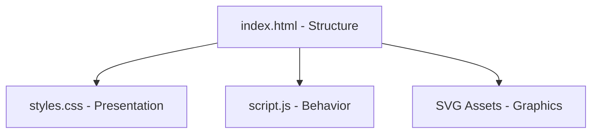
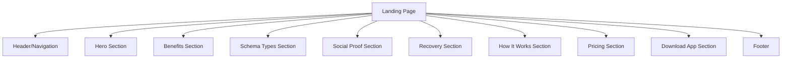

# P18 Schema Test Landing Page System Patterns

## Architecture Overview

The P18 Schema Test landing page follows a simple, modular architecture with clean separation of concerns:

### Component Structure

The landing page is organized into distinct sections, each with its own purpose and styling:

## Design Patterns

### CSS Organization
- **CSS Custom Properties**: All color variables and key dimensions are defined using CSS custom properties (variables) at the root level for easy theming and maintenance.
- **Mobile-First Responsive Design**: Styles are applied using a mobile-first approach with media queries for larger screens.
- **Component-based CSS**: Styles are organized by component, with each section having its own CSS block.
- **Utility Classes**: Common visual patterns are abstracted into utility classes (like .container).

### JavaScript Patterns
- **Event Delegation**: Event listeners are attached to parent elements where possible for better performance.
- **Module Pattern**: Code is organized using the module pattern via the DOMContentLoaded event.
- **Progressive Enhancement**: JavaScript adds interactivity but the page is fully functional without it.
- **IntersectionObserver**: Used for lazy loading and scroll animations for better performance.

## Key Technical Decisions

### No Framework Approach
The landing page intentionally uses vanilla HTML, CSS, and JavaScript instead of a framework to:
- Minimize bundle size and maximize performance
- Reduce complexity for a single-page application
- Avoid unnecessary dependencies
- Ensure long-term maintainability

### SVG for Icons and Graphics
SVG format is used for all icons and many graphical elements to ensure:
- Crisp rendering at any resolution
- Small file size
- Ability to style with CSS
- Accessibility improvements

### CSS Grid and Flexbox
The layout uses a combination of CSS Grid and Flexbox to create:
- Complex, responsive layouts without media query bloat
- Proper alignment and spacing
- Flexible card layouts that respond to screen size

### Semantic HTML
The page uses semantic HTML elements throughout to:
- Improve accessibility
- Enhance SEO
- Create a logical document structure
- Support assistive technologies

## Animation Strategy
Animations are used thoughtfully to enhance the user experience:
- Subtle hover effects on interactive elements
- Scroll-triggered animations for content as it enters the viewport
- Loading animations to provide visual feedback
- Floating elements in the hero section for visual interest

All animations are implemented with considerations for users who prefer reduced motion.

## Performance Considerations
- SVG optimization for smaller file sizes
- Efficient CSS selectors
- Minimal and optimized JavaScript
- Proper image sizing and optimization
- Responsive design techniques that minimize asset duplication
- Async loading of non-critical resources 